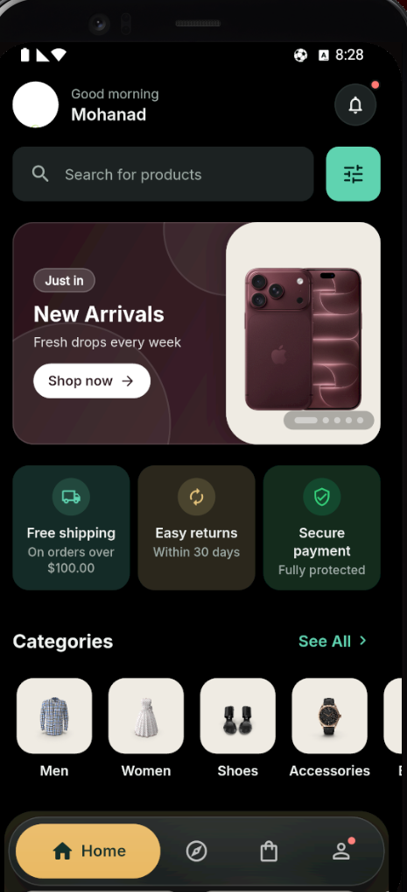
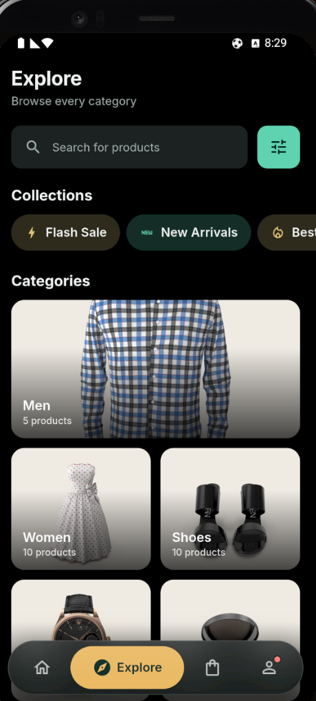
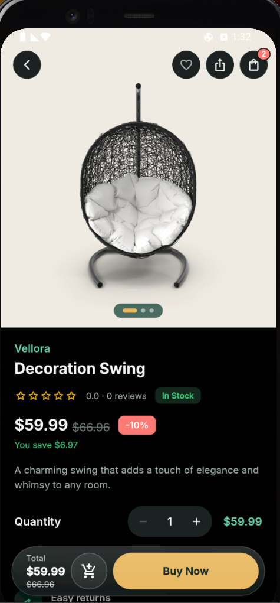
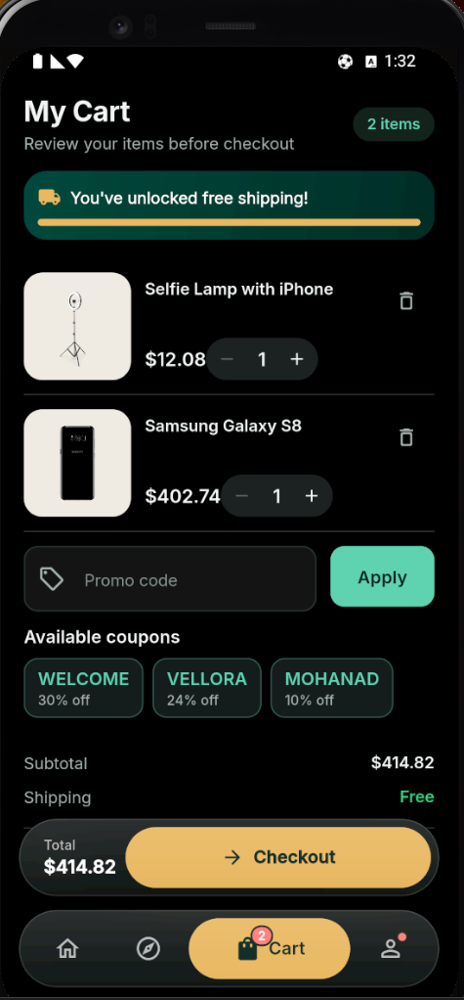
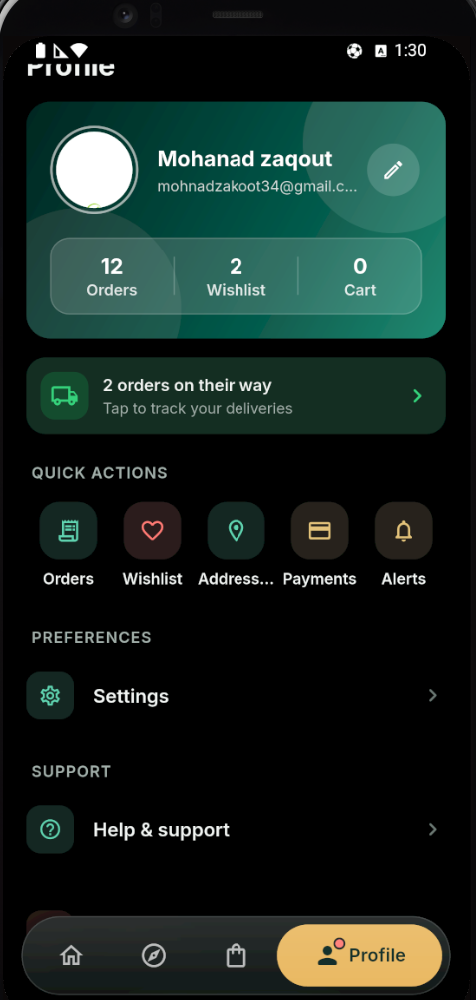
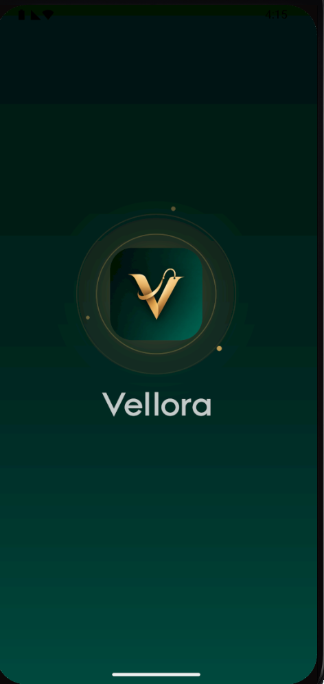
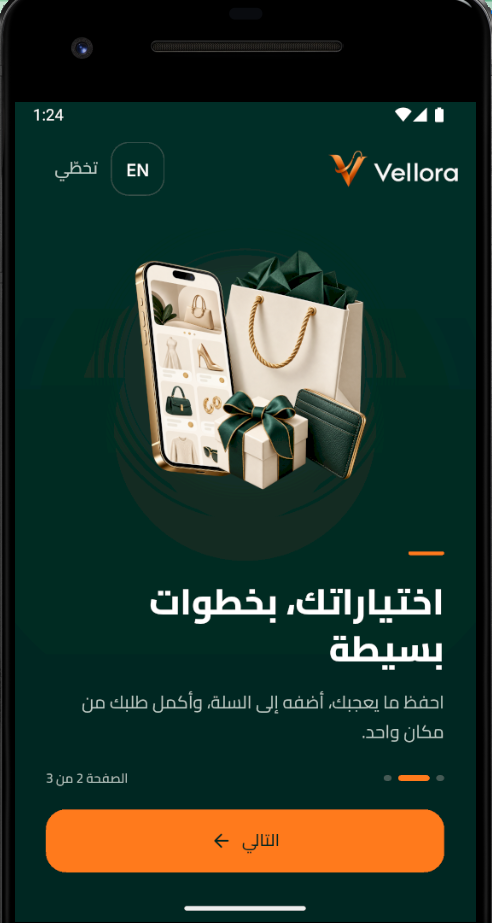
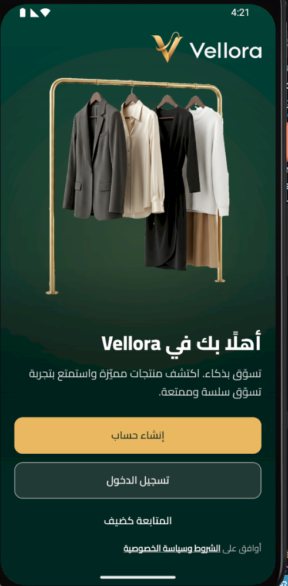
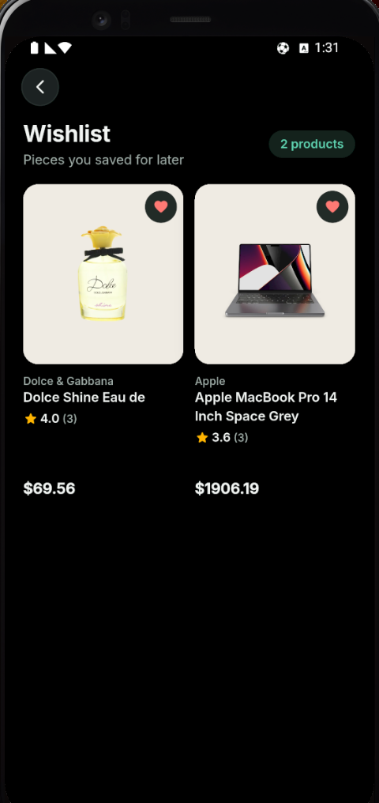

<div align="center">


**A premium fashion e-commerce app built with Flutter, Clean Architecture & Bloc.**

[](https://flutter.dev)
[](https://dart.dev)
[](https://bloclibrary.dev)
[](#-architecture)
[](#-license)

</div>

<p align="center">
  
  
  
  
  
</p>

---

## 📖 Overview

**Vellora** is a complete shopping experience, from the first launch to order
confirmation and what comes after: onboarding, sign-in (password or **Google**), a tabbed
storefront (Home, Explore, Cart, Profile), search with filters, checkout, orders, returns,
notifications (in-app and push) and settings. The wishlist lives in the Profile tab.

It follows the device language: full **English & Arabic** support (true RTL mirroring, Arabic is
the fallback), **light and dark themes**, responsive layouts, accessibility semantics, and
skeleton / empty / error states throughout.

> **Backend:** the Node.js API (Express + PostgreSQL, JWT auth, orders, returns, wishlist,
> notifications) lives in its own repository,
> [`mohanad-2003/vellora-api`](https://github.com/mohanad-2003/vellora-api), and the shop is run
> from a separate back-office website,
> [`mohanad-2003/vellora-admin`](https://github.com/mohanad-2003/vellora-admin) (see
> [*The three repositories*](#-the-three-repositories)). Products, reviews and **all product,
> category and banner photos** come from the Vellora API (the catalogue was seeded from the
> public [DummyJSON](https://dummyjson.com) API and is now edited in the back office). The app
> bundles only the logo, the onboarding / welcome pictures and the social-login icons.

---

## 🧩 The three repositories

| Repository | What it is | Where it runs |
|---|---|---|
| **vellora** (this one) | The customer app (Flutter: Android, iOS, web, desktop) | Phones |
| [**vellora-api**](https://github.com/mohanad-2003/vellora-api) | The API: catalogue, accounts, orders, returns, reviews, coupons, notifications, push, back-office routes under `/admin` | Render (free plan) + PostgreSQL on Neon |
| [**vellora-admin**](https://github.com/mohanad-2003/vellora-admin) | The back office (React): dashboard and analytics, orders and returns, customers, products, **inventory and stocktake**, reviews, categories, banners, coupons, team, store settings, activity log. Installable as an app, Arabic and English | Render (static site) |

What the owner changes in the back office reaches the app without a new release: products and
prices, banners, coupons, **shipping fees and free-shipping threshold**, the support e-mail and
phone shown under Help & support, and the shop's reply to a return request.

---

## 📸 Screenshots

<details open>
<summary><b>First launch</b>: splash, onboarding and welcome (Arabic, RTL)</summary>
<br/>
<div align="center">

<table>
<tr>
<td align="center"><br/><sub><b>Splash</b></sub></td>
<td align="center"><br/><sub><b>Discover</b></sub></td>
<td align="center"><br/><sub><b>Shop with ease</b></sub></td>
<td align="center"><br/><sub><b>Fast &amp; secure delivery</b></sub></td>
<td align="center"><br/><sub><b>Welcome</b></sub></td>
</tr>
</table>

</div>
</details>

<details open>
<summary><b>Storefront</b>: home, explore and product details</summary>
<br/>
<div align="center">

<table>
<tr>
<td align="center"><br/><sub><b>Home</b></sub></td>
<td align="center"><br/><sub><b>Explore</b></sub></td>
<td align="center"><br/><sub><b>Product details</b></sub></td>
</tr>
</table>

</div>
</details>

<details open>
<summary><b>Shopping &amp; account</b>: cart, wishlist and profile</summary>
<br/>
<div align="center">

<table>
<tr>
<td align="center"><br/><sub><b>Cart &amp; free-shipping progress</b></sub></td>
<td align="center"><br/><sub><b>Wishlist</b></sub></td>
<td align="center"><br/><sub><b>Profile</b></sub></td>
</tr>
</table>

</div>
</details>

> The app is fully bilingual: the first-launch screens above are shown in Arabic
> (right-to-left), the storefront in English. Light and dark themes are both supported.

---

## ✨ Features

| Area | Highlights |
|------|-----------|
| 🌐 **Language** | Follows the device language (English or Arabic, Arabic as the fallback); switchable in Settings, and the screen flips to RTL at once |
| 🚀 **Onboarding** | Immersive full-bleed pages with parallax, skip / next flow, then a welcome screen |
| 🔐 **Authentication** | Login and Sign Up (with a password-strength meter), **Continue with Google** (sign in or create the account; an existing account with the same verified e-mail is linked, not duplicated), Forgot Password with a 6-digit code, two-factor sign-in, biometric login |
| 🏠 **Home** | Promo banners (open a product, category or collection), categories, curated product rows, countdown deals |
| 🧭 **Explore & Search** | Category browsing, search with sort and filter sheet |
| 📦 **Product details** | Gallery, size / colour variants, reviews with photos (and writing one), related products, share |
| ❤️ **Wishlist** | Opened from Profile. Favourites work for guests and sync to the account on sign-in (merged, nothing lost) |
| 🛒 **Cart & Checkout** | Quantity control, live totals, delivery methods, free-shipping progress; fees and threshold come from the server |
| 🧾 **Orders** | Place orders, order history and details (server-side totals), cancel while processing, **order again**, order timeline |
| ↩️ **Returns** | Ask to send items of a delivered order back (within 14 days of delivery, per item and quantity, with a reason) and follow the shop's decision |
| 📍 **Addresses & cards** | Saved on the server per account (cards keep only brand, last four digits and expiry); used at checkout |
| 🔒 **Account security** | Change password, two-factor authentication, delete account (password-confirmed) |
| 👤 **Profile** | Profile picture (camera or gallery), edit name, language and theme |
| 🔔 **Notifications** | Notification centre (server feed, unread dot on Home) and **push notifications** (Firebase Cloud Messaging) in the reader's language |
| ❓ **Help & support** | The support e-mail and phone set in the back office (tap to write or call) |
| 🎨 **Design system** | Colour tokens, Inter / Cairo typography, spacing and radius scales |
| ♿ **Accessibility** | Semantics labels, 48dp touch targets, text scale up to 1.6×, reduced-motion support |
| ✅ **Tested** | Bloc, flow, widget, overflow and accessibility tests |

The bottom navigation (four tabs: Home, Explore, Cart, Profile) uses `StatefulShellRoute` so each tab
keeps its own stack and scroll position, and the cart tab shows a live item-count badge. Wide windows
get a navigation rail instead.

---

## 🏗️ Architecture

Each feature follows **Clean Architecture** in three layers:

```
Presentation  ──▶  Domain  ──▶  Data
 (Bloc / UI)     (Entities,     (Models,
                  UseCases,      DataSources,
                  Repo contracts) Repo impls)
```

Cross-cutting code (DI, theme, routing, localization, shared widgets) lives in
[`lib/core/`](lib/core/).

```
lib/
├── app.dart                  # Root MaterialApp (theme, locale, router)
├── main.dart                 # Bootstrap: Hive, DI, runApp
├── core/
│   ├── constants/            # App constants, asset paths
│   ├── di/                   # get_it + injectable
│   ├── localization/l10n/    # ARB files & generated localizations
│   ├── mock/                 # Tiny fixtures for the test suite only
│   ├── responsive/           # Breakpoints, grid columns, page gutters
│   ├── routing/              # go_router config, shell, route names
│   ├── theme/                # Colours, typography, spacing, radius, themes
│   ├── utils/                # Haptics, validators, helpers
│   └── widgets/              # Shared components (buttons, cards, logo, states…)
└── features/
    ├── splash/   onboarding/   auth/        home/       explore/
    ├── catalog/  product/      wishlist/    cart/       checkout/
    └── orders/   notifications/   settings/   profile/
```

---

## 🧰 Tech Stack

| Category | Packages |
|----------|----------|
| **State management** | `flutter_bloc`, `equatable` |
| **Routing** | `go_router` |
| **Dependency injection** | `get_it`, `injectable` |
| **Code generation** | `freezed`, `json_serializable`, `build_runner` |
| **Local storage** | `hive`, `shared_preferences`, `flutter_secure_storage` |
| **Networking** | `dio`, `retrofit` |
| **Functional errors** | `fpdart` |
| **UI** | `cached_network_image`, `flutter_svg`, `lottie`, `shimmer`, `responsive_framework` |
| **Sign-in & security** | `google_sign_in`, `local_auth` (biometrics), `flutter_secure_storage` |
| **Push, media & sharing** | `firebase_messaging`, `image_picker`, `share_plus`, `url_launcher` |
| **Monitoring** | `sentry_flutter` (optional, off by default) |
| **Testing** | `bloc_test`, `mocktail`, `flutter_test` |
| **Tooling** | `flutter_launcher_icons` |

---

## 🎨 Design System & Branding

- **Colours** — [`app_colors.dart`](lib/core/theme/app_colors.dart): the emerald and champagne
  identity (emerald `#0F5C4D`, dark-mode emerald `#5FD3B0`, champagne accent `#B8923F`, ivory
  background `#F8F6F1`), a `VelloraColors` theme extension (`context.vellora`, with the sale red,
  success and warning tones), and the brand gold / deep emerald (`kBrandGold`, `kBrandNavy`)
  used on the dark brand screens (onboarding, welcome, sign-in).
- **Typography** — Inter (Latin) and Cairo (Arabic), bundled as variable fonts.
- **Tokens** — [`app_spacing.dart`](lib/core/theme/app_spacing.dart) (4pt scale),
  [`app_radius.dart`](lib/core/theme/app_radius.dart),
  [`app_theme.dart`](lib/core/theme/app_theme.dart) (light & dark, per locale).
- **Brand assets** — [`assets/branding/`](assets/branding/). The logo widgets
  (`VelloraLogo`, `VelloraMark`, `VelloraWordmark`) pick the right variant for light /
  dark and are never mirrored in RTL.
- **Regenerating brand images and icons** — sources are in
  [`design/branding_source/`](design/branding_source/):

  ```bash
  python design/branding_source/generate_branding.py   # rebuilds assets/branding/
  dart run flutter_launcher_icons                       # app icons for all platforms
  ```

The Android application id is `com.vellora.shop`. The iOS bundle id is still the placeholder
`com.example.uiKit`: change it before publishing on iOS.

---

## 🚀 Getting Started

### Prerequisites

- [Flutter SDK](https://docs.flutter.dev/get-started/install) **≥ 3.47** (Dart **≥ 3.13**)
- A device or emulator (Android, iOS, web or desktop)

### Run

```bash
git clone https://github.com/mohanad-2003/vellora.git
cd vellora

flutter pub get
dart run build_runner build --delete-conflicting-outputs   # DI, freezed, json
flutter gen-l10n                                           # localizations
flutter run
```

**Which server does it talk to?** Release builds use the live API
(`https://vellora-api-pptv.onrender.com`). Debug builds default to an API on your own machine:
`http://10.0.2.2:3000` on the Android emulator, `http://localhost:3000` elsewhere. So either start
the API locally (needs Node 22+, see its README):

```bash
git clone https://github.com/mohanad-2003/vellora-api.git
cd vellora-api && npm install && npm start      # http://localhost:3000
```

or point the app at the live one (or any other server) when you run it:

```bash
flutter run --dart-define=API_BASE_URL=https://vellora-api-pptv.onrender.com
flutter run --dart-define=API_BASE_URL=http://192.168.1.20:3000    # a real phone on your Wi-Fi
```

The live API runs on Render's free plan, which sleeps when idle: the first request after a
quiet spell can take up to a minute (the app waits for it and warms the server up at start).
Deploying your own copy of the API: see the
[API repository](https://github.com/mohanad-2003/vellora-api#deploy-on-render).

Debug and profile Android builds allow plain HTTP for local development; release builds
need an HTTPS `API_BASE_URL`. Without an email provider, the password-reset code is
printed in the backend log (and in the app's debug console).

### Continue with Google (setup)

The button works once three things are in place; none of them is a code change:

1. In the Firebase project of the app, **Authentication → Sign-in method → Google** is enabled, and
   the SHA-1 of the key that signs your build is added under **Project settings → your Android app →
   SHA certificate fingerprints**. For a debug build that key is `~/.android/debug.keystore`:
   `keytool -list -v -keystore ~/.android/debug.keystore -alias androiddebugkey -storepass android`.
   Add the release key's SHA-1 the same way before publishing.
2. `android/app/google-services.json` is the file Firebase generates **after** step 1 (it contains an
   Android OAuth client and a Web client). Download it again whenever you add a fingerprint, then run
   `flutter clean`. The app reads the Web client id from it (`default_web_client_id`); override it with
   `--dart-define=GOOGLE_SERVER_CLIENT_ID=...` if needed.
3. The API trusts that Web client id: set `GOOGLE_CLIENT_IDS` on the server (Render → Environment).
   Until then the server answers "Google sign-in is not set up" and the app says so.

The device (or emulator) needs a Google account added in its settings; without one the button
tells you to add one. Sign in with Apple and Facebook are not connected yet (their buttons say so).

### Localization

Strings live in [`lib/core/localization/l10n/`](lib/core/localization/l10n/)
(`app_en.arb` is the template, plus `app_ar.arb`). Regenerate after editing:

```bash
flutter gen-l10n
```

The brand name **Vellora** stays in Latin script in Arabic text.

---

### Crash reporting (optional)

Errors can be sent to [Sentry](https://sentry.io). It is off unless the app is built with a DSN:

```bash
flutter build apk --dart-define=SENTRY_DSN=https://<key>@<org>.ingest.sentry.io/<project>
```

Nothing identifying is sent: no user or IP address, no screenshots, web requests are kept out of the trail and email
addresses are masked in every message. Without the define, reporting does nothing.

## 🧪 Testing

```bash
flutter analyze
flutter test
```

The suite has several hundred tests (`flutter test` runs them all). Highlights:

| Suite | Covers |
|-------|--------|
| `test/app_flow_test.dart`, `test/pre_home_flow_test.dart` | Splash, onboarding, welcome and the sign-in / sign-up / forgot-password flows |
| `test/pre_home_overflow_test.dart`, `test/auth_no_scroll_test.dart` | Auth layouts at different sizes and text scales (no overflow, no scrolling) |
| `test/google_sign_in_test.dart` | Continue with Google: token → server, two-factor, every failure message |
| `test/order_returns_test.dart`, `test/features/favorites_and_orders_test.dart` | Orders, reorder and return requests |
| `test/shop_settings_test.dart` | Shipping rules and support contacts from the server |
| `test/features/auth/`, `test/features/cart/`, `test/features/product/`, `test/features/profile/` | Blocs and cubits |
| `test/a11y_labels_test.dart`, `test/states_test.dart`, `test/stability_test.dart` | Accessibility labels, loading / empty / error states, robustness |

-------|--------|
| `test/app_flow_test.dart` | Splash, language, onboarding and navigation flow |
| `test/pre_home_flow_test.dart` | Welcome → Login / Register / Forgot password |
| `test/pre_home_overflow_test.dart` | Pre-home layouts at different sizes and text scales |
| `test/wishlist_profile_test.dart` | Wishlist and profile |
| `test/features/auth/auth_bloc_test.dart` | Auth Bloc |
| `test/features/cart/cart_bloc_test.dart` | Cart Bloc |

---

## 🗺️ Roadmap

- [x] Design system, branding, light / dark and RTL
- [x] Onboarding, authentication, storefront, search & filters
- [x] Cart, checkout, orders, notifications, settings
- [x] Node.js backend ([`vellora-api`](https://github.com/mohanad-2003/vellora-api), separate repository)
- [x] Flutter app connected to the backend (home, catalogue, product, auth, promo, orders, notifications)
- [x] Back office ([`vellora-admin`](https://github.com/mohanad-2003/vellora-admin), separate repository)
- [x] Push notifications, two-factor sign-in, profile picture, order again
- [x] Localized notifications and bilingual product names (the API stores Arabic alongside English)
- [x] Returns and Continue with Google
- [ ] Payment gateway (cash on delivery only for now)
- [ ] Sign in with Apple and Facebook
- [ ] iOS bundle id, release signing and tablet / landscape verification on real devices

---

## 📄 License

This project is **private** and not published to pub.dev (`publish_to: none`).
All rights reserved © 2026.
